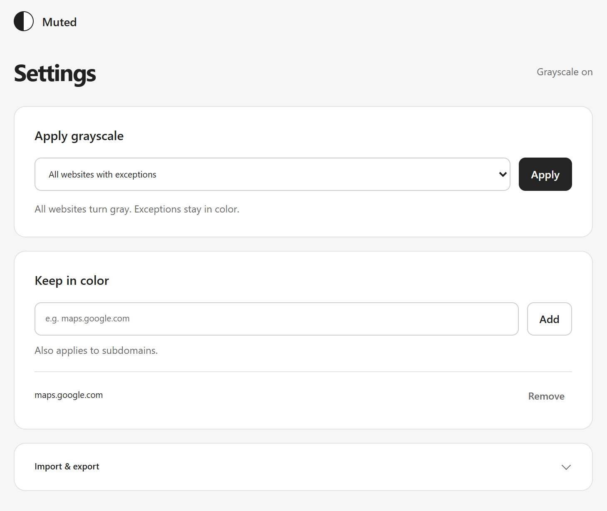

# Muted

Muted is a Chrome and Edge extension that applies a grayscale filter to websites.
It can run on all websites with exceptions, or only on websites you select.



## Usage

The toolbar popup lets you change the current website's rule, turn the filter on or off,
or pause it for 5, 15, or 30 minutes.

In **Settings**, you can switch modes, edit website lists, and import or export them as JSON.
Website rules include subdomains. Both lists are kept when you switch modes.

The interface uses your browser's language: German or English, with English as the fallback.

## Install

No build step is needed.

1. Download the `muted-….zip` package from the [latest release](https://github.com/stefanvictora/muted/releases/latest).
2. Extract the ZIP into a folder you will keep on your computer.
3. Open `chrome://extensions` in Chrome or `edge://extensions` in Edge.
4. Enable **Developer mode**.
5. Click **Load unpacked** and select the package's `extension` folder.
6. Pin Muted to the toolbar, open its popup, and click **Allow access**.

You can also clone this repository and load its `extension` folder directly.
Disable other copies of Muted to avoid running multiple instances.

Updates are manual. For controls, updates, and troubleshooting, see [Installation and usage](docs/INSTALLATION.md).

## Privacy and permissions

Settings are stored locally in each browser. The extension makes no network requests.

Both modes require a one-time grant of access to all HTTP and HTTPS websites so Muted can
apply and remove the filter. Your website lists determine where grayscale is active;
they do not restrict the extension's browser permissions. You can revoke access in your
browser's extension settings.

Browser pages, extension stores, private windows, local files, and PDF viewers are not supported.
See [Permissions and limitations](docs/SECURITY.md) for details.

## Development

Use Node.js 22.12 or newer:

```powershell
npm ci
npm run check               # Check formatting and run tests
npm run package             # Optional: create a package under releases/
```

See [Development](docs/DEVELOPMENT.md) for architecture, translations, browser checks, and packaging.
See [CHANGELOG.txt](CHANGELOG.txt) for release history.

## License

[MIT](LICENSE) © 2026 Stefan Victora.
